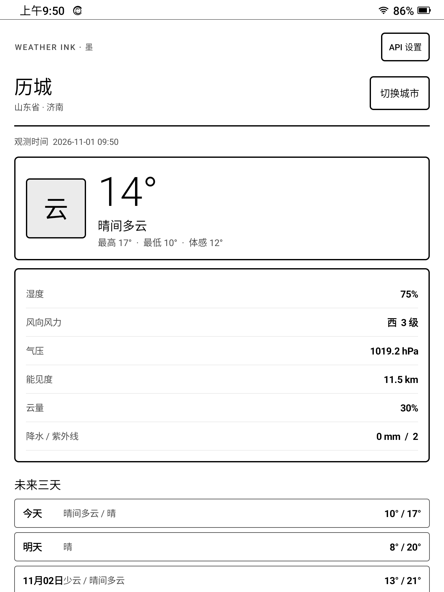

# 墨天气

面向安卓 11 墨水屏设备的轻量天气应用，使用和风天气 QWeather Web API。



当前版本使用 QWeather 新版 `/weather/v1/current`、`/weather/v1/daily`
及 `/geo/v2/city/lookup` 接口。

## 功能

- 不使用 GPS，不申请定位权限
- 按城市名或 QWeather Location ID 手动搜索、添加城市
- 当前天气、体感温度、湿度、风力、气压、能见度
- 未来三天预报
- 黑白高对比界面，无动画、无阴影、无渐变
- 打开应用时自动刷新一次，也可手动刷新
- 天气数据和城市列表保存在本机

## QWeather 注册

QWeather 开发服务需要自行注册：

1. 打开 [QWeather 开发者控制台](https://console.qweather.com/) 注册并登录。
2. 创建项目和 API Key。
3. 在控制台找到你的专属 API Host，例如 `abcxyz.qweatherapi.com`。
4. 在应用“API 设置”中填写 API Host 与 API Key。

API Key 不会打包进 APK，只保存在设备应用私有目录。应用不进行后台轮询。

## 构建

环境要求：

- JDK 17
- Android SDK Platform 34
- Android Build Tools 34.0.0

设置 `ANDROID_HOME` 后执行：

```powershell
.\gradlew.bat assembleDebug
```

调试 APK 输出到：

```text
app\build\outputs\apk\debug\app-debug.apk
```

安装到已连接 ADB 的设备：

```powershell
adb install -r app\build\outputs\apk\debug\app-debug.apk
```

## 项目结构

- `MainActivity`：天气主页和墨水屏排版
- `CityActivity`：城市搜索、保存、切换和删除
- `SettingsActivity`：API Host、API Key 和缓存管理
- `QWeatherClient`：QWeather Web API 请求及中文错误提示
- `Preferences`：本机设置、城市和天气缓存

应用最低支持 Android 6.0，已在 Android 11 的 N10 Touch 上验证，使用原生 Java 和 Android 平台控件实现。
